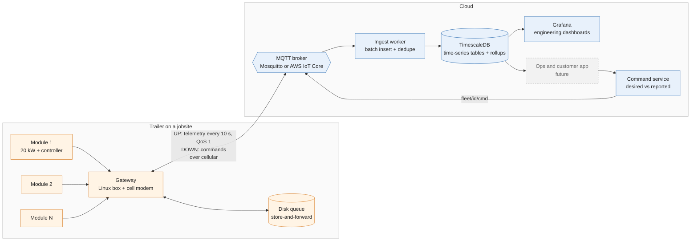
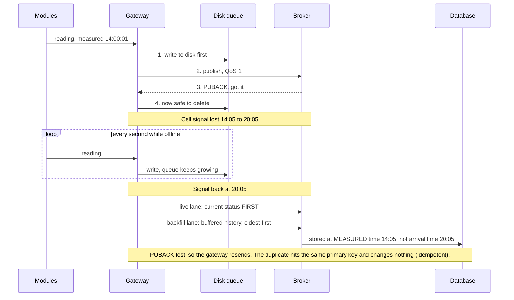
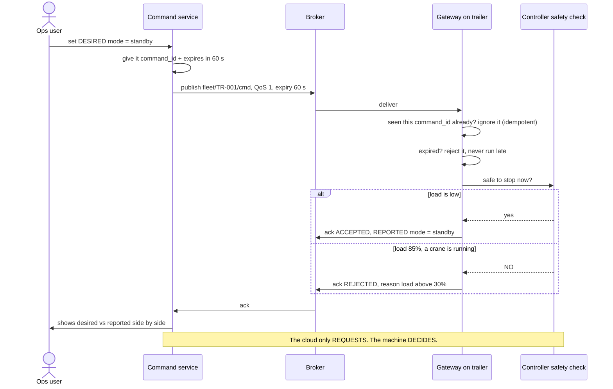
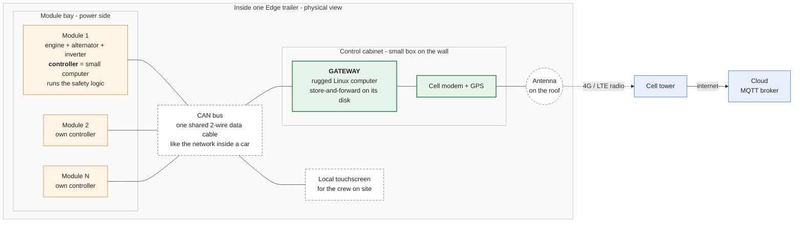

# Architecture diagrams

Sources are Mermaid (`docs/diagrams/*.mmd`; GitHub renders them below). PNGs are for printing.

## System data flow

Where the data goes, from module to dashboard, and how commands come back down.

PNG: [diagrams/1-data-flow.png](diagrams/1-data-flow.png)

## Store-and-forward through a cell outage

Nothing is lost, nothing is double-counted, and history lands at the time it was measured.

PNG: [diagrams/2-store-and-forward.png](diagrams/2-store-and-forward.png)

## Remote command path

The cloud requests; the machine decides. Commands are idempotent and expire.

PNG: [diagrams/3-command-path.png](diagrams/3-command-path.png)

## Inside one trailer (physical view)

Where the gateway physically lives. Each module has its own controller, which runs the safety logic. All controllers share one CAN bus data cable. The gateway sits in the control cabinet and is the only thing that talks to the internet, like a home Wi-Fi router. (In this simulator the modules and gateway are one Python process.)

PNG: [diagrams/4-inside-the-trailer.png](diagrams/4-inside-the-trailer.png)
